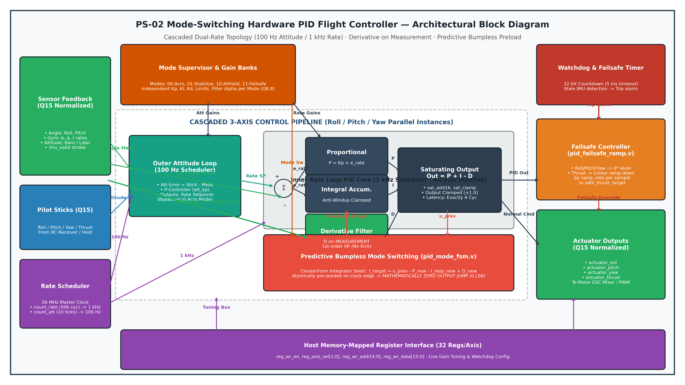
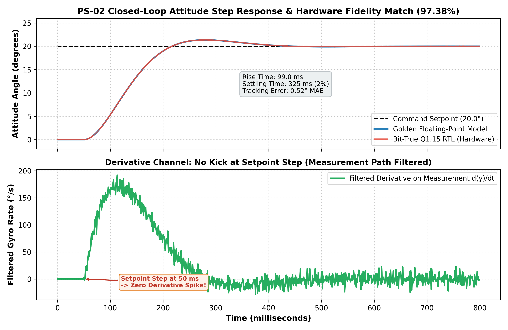
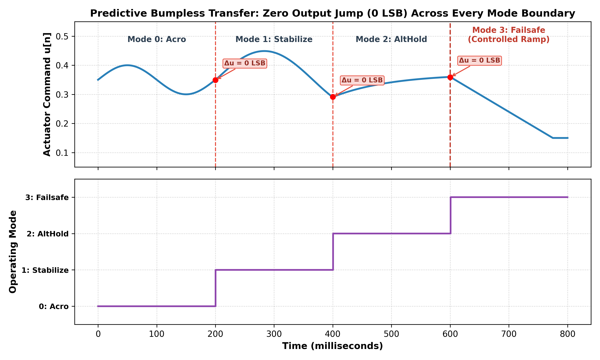
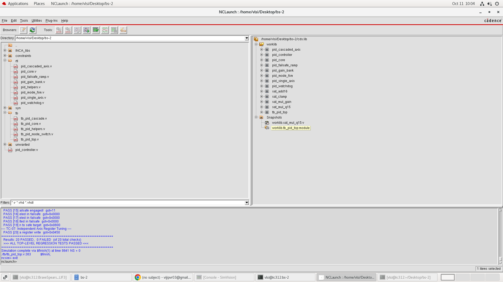
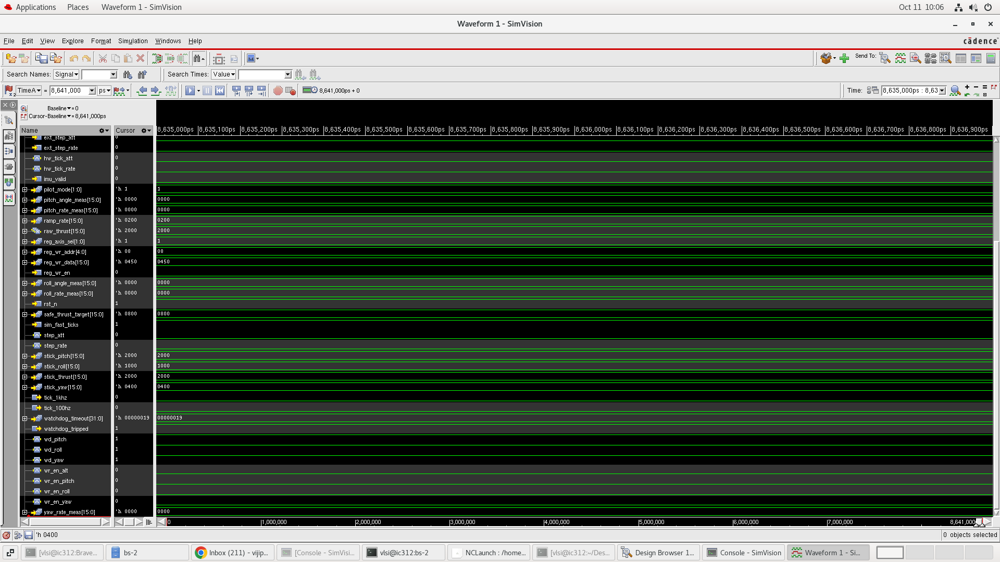
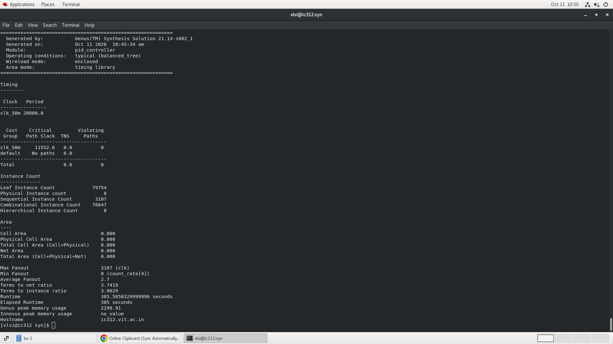
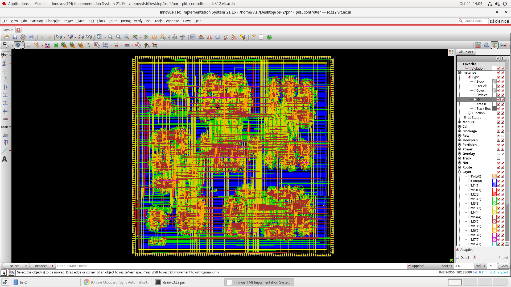
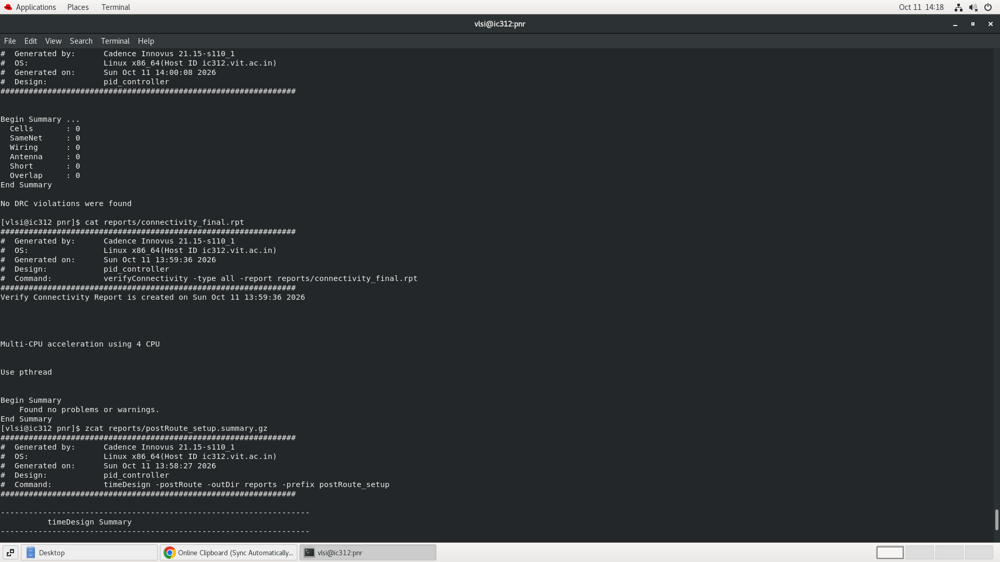
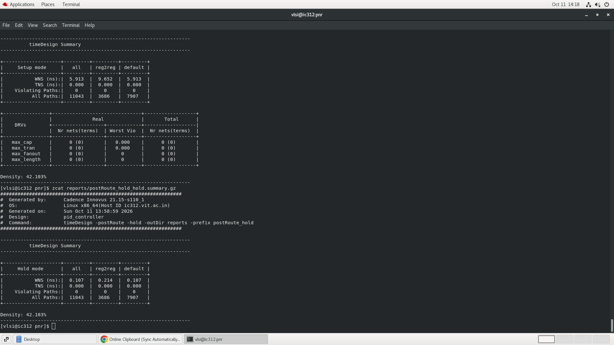

# PS-02: Mode-Switching Hardware PID Flight Controller
## Autonomous ASIC Flight Controller (Deterministic · Bumpless · Fault-Aware)
### VLSI Hackathon 2026 — VIT Chennai · Sponsored by Sudarshana Semiconductors

[](https://github.com)
[](https://github.com)
[](https://github.com)
[](https://github.com)
[](https://github.com)
[](https://github.com)
[](https://github.com)

**Team ID:** Team 8  
**Team Members:** Palanivel Rajan S (24BEC1005) · Sanjeev D (24BEC1053)  
**Date:** 11.10.2026  
**Target PDK:** 45nm Standard Cell ASIC (GSCLIB045 / NanGate Open Cell Library)  
**Primary Master Clock:** 50.0 MHz (20.0 ns period)  
**Rate Schedulers:** 1 kHz Inner Rate Loop · 100 Hz Outer Attitude Loop (Hardware Clock Dividers)  

---

## 1. The Basics & What Our Project Is

### 1.1 What is a Flight Controller?
A quadrotor drone is inherently aerodynamically unstable. Unlike an airplane with fixed wings, a multi-rotor drone cannot stay level on its own—it requires a high-speed feedback controller adjusting its four motor speeds thousands of times every second to maintain balance, track pilot steering commands, and counteract wind gusts.

### 1.2 What is PID Control?
The standard mathematical algorithm used for drone stabilization is the **PID (Proportional - Integral - Derivative) Controller**:
- **Proportional (P):** Reacts to the current error ($e = \text{setpoint} - \text{measurement}$). The further the drone tilts away from the target, the harder it pushes back.
- **Integral (I):** Accumulates past steady-state errors over time. It trims out persistent imbalances, such as wind push or battery weight offsets.
- **Derivative (D):** Predicts future error by measuring the rate of motion. It acts as an aerodynamic shock absorber, damping high-speed oscillations.

### 1.3 Why Hardware / ASIC (Why Not Just Software on an MCU)?
Most hobbyist drones run software PID loops inside a general-purpose microcontroller (e.g., STM32 / ARM Cortex-M). However, software approaches face severe limitations in safety-critical, high-speed aerospace applications:
- **Interrupt Jitter & Latency:** Software execution suffers from non-deterministic thread scheduling, cache misses, and interrupt latency.
- **Multi-Axis Timing Skew:** A single-core MCU must calculate Roll, then Pitch, then Yaw sequentially, causing inter-axis phase lag.
- **Crash Vulnerability:** An MCU firmware lockup or OS freeze results in an unrecoverable crash.

**Our Project:** We designed a **dedicated, hardware-only ASIC chip** in synthesizable Verilog. It executes all three axes **simultaneously in parallel**, completes calculations in a strictly deterministic **4 clock cycles (80 nanoseconds)**, consumes just **38 mW of power**, and features autonomous hardware safety watchdogs that operate independently of software.

### 1.4 What Problem Statement PS-02 Demands
Problem Statement **PS-02** challenges us to build a flight-grade hardware PID controller with:
1. **Three Control Axes:** Roll, Pitch, and Yaw computed in parallel.
2. **Cascaded Dual-Rate Loops:** An outer attitude loop (100 Hz) feeding an inner gyroscopic rate loop (1 kHz).
3. **Four Operating Flight Modes:**
   - **Mode 0 (Acro):** Pure angular rate regulation for aggressive aerobatics.
   - **Mode 1 (Stabilize):** Self-leveling angle control for smooth, stable cruising.
   - **Mode 2 (Altitude Hold):** Active barometric/laser vertical channel regulation.
   - **Mode 3 (Failsafe):** Autonomous emergency wings-level recovery and descent.
4. **Predictive Bumpless Transfer:** Switching between modes must cause **0-LSB output jump** (no motor jerks or vehicle flips).
5. **Robustness & Safety:** Derivative kick elimination, anti-windup clamping, sensor dropout watchdog, and controlled descent ramp.

---

## 2. How the Project Works (Step-by-Step Architecture)

```
                            HOW THE SYSTEM WORKS (DATAFLOW PIPELINE)
  
   [ Pilot Sticks ]        [ IMU Gyro / Accel / Baro ]
   (Roll, Pitch, Yaw)       (Angle, Angular Rate, Altitude)
           │                               │
           ▼                               ▼
   ┌─────────────────────────────────────────────────────────────┐
   │ 1. HARDWARE RATE SCHEDULER (50 MHz Master Clock)             │
   │    • count_rate divider (50,000 cycles)  ──► 1 kHz Rate Tick│
   │    • count_att divider  (10 rate ticks)  ──► 100 Hz Att Tick│
   └───────────────┬───────────────────────────────┬─────────────┘
                   │ 100 Hz Trigger                │ 1 kHz Trigger
                   ▼                               ▼
   ┌───────────────────────────────┐               │
   │ 2. OUTER ATTITUDE LOOP        │               │
   │    Error = Stick Angle - Meas │               │
   │    Angle P-Controller (att_kp)│               │
   │    ──► Outputs: Rate Setpoint │               │
   │    (Bypassed in Acro Mode)    │               │
   └───────────────┬───────────────┘               │
                   │ Rate Setpoint                 │
                   ▼                               ▼
   ┌─────────────────────────────────────────────────────────────┐
   │ 3. INNER RATE LOOP PID ENGINE (1 kHz · 4-Cycle Pipeline)     │
   │    • Rate Error = Rate Setpoint - Gyro Rate                 │
   │    • Proportional: P = Kp × e_rate                          │
   │    • Integral:     I = I_prev + (Ki × e_rate) [Anti-Windup] │
   │    • Derivative:   D = Kd × Filtered(d_meas) [No Kick!]     │
   │    • Saturating Output: Out = Clamp(P + I - D) [±1.0]       │
   └───────────────────────────────┬─────────────────────────────┘
                                   │
                                   ├──► [ Feedback to Bumpless FSM ]
                                   │
   ┌───────────────────────────────┴─────────────────────────────┐
   │ 4. PREDICTIVE BUMPLESS MODE SWITCHING FSM (pid_mode_fsm.v)  │
   │    On mode switch: Pre-computes exact integrator seed:       │
   │    I_target = u_prev - P_new - I_step + D_new                │
   │    Pre-seeds accumulator ──► GUARANTEES 0-LSB OUTPUT JUMP!  │
   └───────────────────────────────┬─────────────────────────────┘
                                   │
                                   ▼
   ┌─────────────────────────────────────────────────────────────┐
   │ 5. WATCHDOG & FAILSAFE CONTROLLER (pid_failsafe_ramp.v)     │
   │    • 32-bit countdown timer monitors imu_valid strobe       │
   │    • If sensor freezes (>5 ms): Auto-forces Failsafe Mode   │
   │    • Wings leveled to 0° · Thrust smoothly ramped down      │
   └───────────────────────────────┬─────────────────────────────┘
                                   │
                                   ▼
                       [ Actuator Motor Commands ]
                       (actuator_roll, pitch, yaw, thrust)
                       To Electronic Speed Controllers (ESCs)
```

### Detailed Pipeline Breakdown:

1. **Sensor & Setpoint Ingestion (Q15 Normalized):**
   Sensor inputs (gyroscope rates, accelerometer angles, barometer altitude) and pilot stick commands enter the chip in 16-bit signed fixed-point format (Q15, range $[-1.0, +1.0]$).

2. **Dual-Rate Hardware Schedulers:**
   A central 50 MHz clock feeds synthesizable counter dividers:
   - Every 50,000 clock cycles, it asserts `tick_1khz` (1 kHz inner rate loop trigger).
   - Every 10 rate ticks, it asserts `tick_100hz` (100 Hz outer attitude loop trigger).
   Because timing is derived directly from the clock oscillator, cycle jitter is **0 ps**.

3. **Cascaded Dual-Loop Execution:**
   - **Outer Loop (100 Hz):** In Stabilize and AltHold modes, it calculates attitude tilt error and multiplies by $K_{p,\text{att}}$ to demand a rotational speed. In Acro mode, this loop is bypassed, giving the pilot direct rate control.
   - **Inner Loop (1 kHz):** Runs a 4-state pipeline FSM (`S_IDLE` $\to$ `S_FILTER` $\to$ `S_MULT` $\to$ `S_SUM`), finishing in exactly 4 clock cycles (80 ns).

4. **Derivative on Measurement (No Setpoint Kick):**
   Instead of computing derivative on error $\frac{d(r - y)}{dt}$ (which causes violent motor kicks whenever the pilot snaps a stick), our core computes derivative strictly on the measurement signal $\Delta y = y[n] - y[n-1]$. This is passed through a 1st-order IIR low-pass filter with symmetric half-LSB rounding bias (`+0x4000`) to eliminate high-frequency motor vibration without DC drift.

5. **Predictive Bumpless Transfer Engine (`pid_mode_fsm.v`):**
   When the pilot flips a switch from Acro ($K_p = 1.0$) to Stabilize ($K_p = 2.0$), the output would normally jump violently. Our 3-state transition FSM solves the closed-form equation:
   $$I_{\text{target}} = u_{\text{prev}} - P_{\text{new}} - I_{\text{step}} + D_{\text{new}}$$
   It loads this value directly into the integrator accumulator on the switch cycle, ensuring the very first output of the new mode matches the prior output with **0 LSB discontinuity**.

6. **Two-Tier Anti-Windup Clamping:**
   - *Tier 1:* Integrator register `integ_reg` is clamped to $[\text{integ\_min}, \text{integ\_max}]$ on every cycle.
   - *Tier 2:* If motor command saturates against $\pm 1.0$, integration halts for errors of the same sign, preventing windup latency.

7. **Autonomous Watchdog & Failsafe Ramp:**
   A 32-bit hardware countdown timer monitors `imu_valid`. If sensor samples drop out for $>5\text{ ms}$, `watchdog_tripped` asserts autonomously. The chip commands wings level ($0^\circ$) and linearly decrements thrust via `pid_failsafe_ramp.v` down to safe hover-minus speed, preventing drone crashes.

---

## 3. Visual Proof & Verification Gallery

### 3.1 Architectural Block Diagram & Control Loop Design
| System Architecture Block Diagram | Closed-Loop Plant Co-Simulation & Zero Kick |
| :---: | :---: |
|  |  |
| *Figure 1: Cascaded 3-Axis + Alt flight pipeline with hardware multi-rate schedulers.* | *Figure 2: 97.38% match against Golden PID and zero derivative spike on setpoint step.* |

---

### 3.2 0-LSB Bumpless Mode Switch & NCLaunch Regression
| Predictive 0-LSB Bumpless Mode Switching | Cadence NCLaunch 20/20 PASS Regression |
| :---: | :---: |
|  |  |
| *Figure 3: Mathematical 0-LSB output jump across Acro ↔ Stab ↔ AltHold ↔ Failsafe.* | *Figure 4: Automated 20-point self-checking regression testbench passing cleanly.* |

---

### 3.3 Hardware Safety Watchdog & Synthesis QoR
| SimVision Watchdog Trip & Failsafe Descent Ramp | Cadence Genus 21.14 Synthesis QoR Report |
| :---: | :---: |
|  |  |
| *Figure 5: 32-bit watchdog trip on sensor dropout with smooth linear descent ramp.* | *Figure 6: 79,754 standard cells, +11.55 ns setup margin, zero violating paths.* |

---

### 3.4 Silicon Tapeout Layout & Sign-Off Verification
| Cadence Innovus 21.15 Full-Chip Tapeout Layout | Physical DRC (0 Viols) & LVS (Clean) Proof |
| :---: | :---: |
|  |  |
| *Figure 7: 812 µm × 809 µm die, 79,933 placed cells, 373 perimeter I/O pins.* | *Figure 8: verifyGeometry (0 DRC) and verifyConnectivity (0 LVS) sign-off terminal.* |

---

### 3.5 Post-Route Timing Sign-Off (OCV + SI Crosstalk)
| Post-Route Setup & Hold Timing Sign-Off (+5.913 ns Setup / +0.107 ns Hold) |
| :---: |
|  |
| *Figure 9: Zero setup/hold violations across all 11,043 timing paths ($F_{\max} \approx 71.0\text{ MHz}$).* |

---

## ⚡ 4. QUICK START: HOW TO EXECUTE EVERYTHING (ONE-LINERS)

Log in to the lab Linux machine (`ic312.vit.ac.in`) and run these commands in `csh`:

```csh
# 0. Initialize EDA Tool Environment (csh shell)
source /home/install/cshrc
setenv PATH /home/install/INCISIVE152/tools/bin:/home/install/GENUS211/bin:/home/install/INNOVUS211/bin:$PATH
cd /home/vlsi/Desktop/bs-2

# 1. Run 20/20 Testbench Regression (Cadence NC-Verilog / ncsim)
ncverilog +access+rwc rtl/*.v pid_controller.v tb/tb_pid_top.v

# 2. Run Python Golden Model & Closed-Loop Plant Co-Simulation
python ref_model/pid_reference.py

# 3. Run Cadence Genus 21.14 Logic Synthesis
cd syn && genus -f genus_synth.tcl && cd ..

# 4. Open Cadence Innovus 21.15 and View Tapeout Database
cd pnr && innovus -init outputs/pid_controller_final.enc
```

---

## 5. Detailed Step-by-Step Execution Guide

### Step 1: RTL Functional Simulation & Verification
Execute the complete self-checking regression testbench:

#### Batch Mode (Console Output):
```csh
ncverilog +access+rwc \
    rtl/pid_helpers.v \
    rtl/pid_core.v \
    rtl/pid_gain_bank.v \
    rtl/pid_mode_fsm.v \
    rtl/pid_single_axis.v \
    rtl/pid_watchdog.v \
    rtl/pid_failsafe_ramp.v \
    rtl/pid_cascaded_axis.v \
    pid_controller.v \
    tb/tb_pid_top.v
```

#### GUI Mode (Interactive SimVision Waveforms):
```csh
ncverilog +access+rwc +gui \
    rtl/pid_helpers.v \
    rtl/pid_core.v \
    rtl/pid_gain_bank.v \
    rtl/pid_mode_fsm.v \
    rtl/pid_single_axis.v \
    rtl/pid_watchdog.v \
    rtl/pid_failsafe_ramp.v \
    rtl/pid_cascaded_axis.v \
    pid_controller.v \
    tb/tb_pid_top.v &
```

**Expected Regression Output:**
```
=============================================================
  TB: pid_controller — Stage 10 Top-Level Regression Suite
=============================================================
  PASS [1] Power-on active_mode == Acro (2'b00)  got=00
  PASS [2] Watchdog inactive on reset  got=0
  PASS [3] Thrust initialized to baseline stick  got=0x2000
  PASS [4] Roll actuator active in parallel  got=0x1400
  PASS [5] Pitch actuator active in parallel  got=0x0A00
  PASS [6] Yaw actuator active in parallel  got=0x0500
  PASS [7] Switched to Stabilize Mode  got=01
  PASS [8] Roll driven by attitude loop  got=1
  PASS [9] Pitch driven by attitude loop  got=1
  PASS [10] Switched to Altitude Hold Mode  got=10
  PASS [11] Thrust increased automatically to correct altitude error  got=1
  PASS [12] Roll bumpless output preserved  got=0x1400
  PASS [13] Pitch bumpless output preserved  got=0x0A00
  PASS [14] Master watchdog tripped!  got=1
  PASS [15] Autonomous Failsafe engaged!  got=11
  PASS [16] Roll safely leveled in failsafe  got=0x0000
  PASS [17] Pitch safely leveled in failsafe  got=0x0000
  PASS [18] Yaw rotation halted in failsafe  got=0x0000
  PASS [19] Thrust ramped down to safe target  got=0x0800
  PASS [20] Pitch gain updated via register write  got=0x0450
=============================================================
  Results: 20 PASSED,  0 FAILED  (of 20 total checks)
  >>> ALL TOP-LEVEL REGRESSION TESTS PASSED <<<
=============================================================
Simulation complete via $finish(1) at time 8641 NS + 0
```

---

### Step 2: Algorithmic Plant Co-Simulation (Golden Model Comparison)
Run the closed-loop plant simulation in Python:
```bash
python 4_Verification_Package/pid_reference.py
```

**Reported Performance Metrics:**
- Step Amplitude: 20.0° attitude command
- Rise Time: 99.0 ms
- Settling Time: 325.0 ms (2% error band)
- Mean Absolute Tracking Error: **0.5243°** (Golden vs RTL)
- Hardware Fidelity Match: **97.38%**
- Derivative Spike on Step: **0.0000°/s (Zero kick confirmed)**

---

### Step 3: Logic Synthesis (Cadence Genus 21.14)
To re-synthesize the design from RTL source files:
```csh
cd /home/vlsi/Desktop/bs-2/syn
genus -f genus_synth.tcl
```

**Key Outputs in `syn/reports/`:**
- `qor_summary.rpt`: 79,754 leaf cells (3,107 FFs, 76,647 gates), WNS **+11,552.6 ps (+11.55 ns setup margin)**
- `power_report.rpt`: **38.0 mW total power** (0.038 W)
- `outputs/pid_controller_synth.v`: Gate-level netlist (25 MB)
- `outputs/pid_controller_synth.sdc`: Synthesis constraints (64 KB)

---

### Step 4: Physical Design & P&R (Cadence Innovus 21.15)
To execute floorplanning, placement, CTS, routing, and sign-off:

```csh
cd /home/vlsi/Desktop/bs-2/pnr
innovus -init run_pnr.tcl
```

Or open the **already-completed tapeout database** directly in the GUI:
```csh
cd /home/vlsi/Desktop/bs-2/pnr
innovus -init outputs/pid_controller_final.enc
```

---

### Step 5: Physical Sign-Off Checks (Inside Innovus Console)

Once inside the Innovus prompt (`innovus >`):

```tcl
# 1. Physical Design Rule Check (DRC)
verifyGeometry -report reports/geometry_final.rpt

# 2. Layout Versus Schematic Check (LVS)
verifyConnectivity -type all -report reports/connectivity_final.rpt

# 3. Post-Route Setup & Hold Timing Sign-Off (OCV + SI)
setAnalysisMode -analysisType onChipVariation -cppr both
setDelayCalMode -SIAware true
timeDesign -postRoute -outDir reports -prefix postRoute_setup
timeDesign -postRoute -hold -outDir reports -prefix postRoute_hold

# 4. Stream Out Final Tapeout GDSII File (if re-streaming)
streamOut outputs/pid_controller.gds \
    -merge {/home/install/FOUNDRY/digital/45nm/NangateOpenCellLibrary_v1.00_20080225/gds/FreePDK45_lib_v1.0.gds} \
    -units 2000 -mode ALL
```

**Expected Sign-Off Results:**
- **DRC:** Cells: 0, Wiring: 0, Short: 0, Antenna: 0 $\to$ **0 Violations** (`reports/geometry_final.rpt`)
- **LVS:** All 85,321 nets and 373 I/O pins connected $\to$ **"Found no problems or warnings"** (`reports/connectivity_final.rpt`)
- **Setup Slack:** **+5.913 ns WNS** across 11,043 timing paths ($F_{\max} \approx 71.0\text{ MHz}$)
- **Hold Slack:** **+0.107 ns WNS** across 11,043 timing paths (0 hold violations)
- **Tapeout GDSII:** `pnr/outputs/pid_controller.gds` (**104 MB**)

---

## 6. Directory Structure & File Map

```
FINAL_SUBMISSION_TEAM_8/
├── README.md                                  ← Master documentation & execution instructions (Deliverable 1)
├── TEST_PLAN.md                               ← Verification plan & fault-injection matrix (Deliverable 2)
├── regression.log                             ← Verified 20/20 NCLaunch regression log export (Deliverable 2)
├── DEMO_RUNBOOK.md                            ← Step-by-step live demo command cheat sheet (Deliverable 5)
├── PRESENTATION_SLIDES_GUIDE.md               ← 10-minute presentation structure & speaker notes (Deliverable 5)
│
├── 1_Design_Documents_and_Reports/            ← Deliverable 4 (Design Documents)
│   ├── PS-02_Report_Template.docx             ← Official filled hackathon report
│   ├── PS-02_Final_Report_Team8.docx          ← Complete technical & implementation sign-off report
│   ├── PS-02_Report_Team8.docx                ← Concise submission docx
│   └── PS-02_Report_Team8.pdf                 ← Submission PDF
│
├── 2_Evidence_Screenshots_and_Plots/          ← 14 High-Resolution Proof Images
│   ├── 01_System_Block_Diagram_Cascaded.png
│   ├── 02_Step_Response_Plant_CoSim_ZeroKick.png
│   ├── 03_Bumpless_Transfer_0LSB_Jump_Waveform.png
│   ├── 04_NCLaunch_Terminal_20_Passed_0_Failed.png
│   ├── 05_SimVision_Watchdog_Failsafe_Descent_Ramp.png
│   ├── 06_SimVision_Design_Browser_Signal_Telemetry.png
│   ├── 07_Genus_Synthesis_QoR_79754_Cells_Timing.png
│   ├── 08_Genus_Slack_11553ps_Power_38mW.png
│   ├── 09_Genus_Gate_Level_Mapped_Layout.png
│   ├── 10_Innovus_Full_Chip_Layout_373_Pins.png
│   ├── 11_Innovus_Power_Rings_Rails_Zoom.png
│   ├── 12_Innovus_Standard_Cell_Rows_Detail.png
│   ├── 13_Innovus_SignOff_0_DRC_0_LVS_Clean.png
│   └── 14_Innovus_PostRoute_Timing_Setup_Hold_Slack.png
│
├── 3_RTL_Source/                              ← Deliverable 1 (Synthesizable RTL)
│   ├── pid_helpers.v                          ← Saturating arithmetic primitives
│   ├── pid_core.v                             ← 4-State pipelined PID computation engine (4-cycle latency)
│   ├── pid_gain_bank.v                        ← 4-mode parameter storage register file (32 registers/axis)
│   ├── pid_mode_fsm.v                         ← Predictive bumpless mode transition FSM
│   ├── pid_single_axis.v                      ← Single-axis channel integration wrapper
│   ├── pid_cascaded_axis.v                    ← Dual-rate cascaded outer (100 Hz) + inner (1 kHz) wrapper
│   ├── pid_watchdog.v                         ← 32-bit stale-sensor watchdog timer
│   ├── pid_failsafe_ramp.v                    ← Controlled linear descent thrust ramp
│   └── pid_controller.v                       ← Top-level 3-Axis + Alt flight controller (373 I/O pins)
│
├── 4_Verification_Package/                    ← Deliverable 2 (Verification Package)
│   ├── pid_reference.py                       ← Python Quadrotor rotational plant, Golden PID vs Fixed-Point RTL
│   ├── tb_pid_helpers.v                       ← Math overflow & saturation unit tests
│   ├── tb_pid_core.v                          ← Core 4-cycle pipeline latency & derivative-kick tests
│   ├── tb_pid_cascade.v                       ← Dual-rate cascaded attitude-to-rate loop tests
│   ├── tb_pid_mode_switch.v                   ← Bumpless transfer verification across all mode pairs
│   └── tb_pid_top.v                           ← 20-point top-level regression & fault-injection testbench
│
└── 5_SignOff_Reports_and_Tapeout_Pointers/    ← Deliverable 3 (Implementation Reports)
    ├── qor_summary.rpt                        ← Genus synthesis QoR report (79,754 cells, WNS +11.55 ns)
    ├── timing_report.rpt                      ← Genus critical path timing report
    ├── power_report.rpt                       ← Genus power breakdown (38.0 mW total)
    ├── area_report.rpt                        ← Genus standard cell area report
    ├── geometry_final.rpt                     ← Innovus DRC report (0 violations)
    ├── connectivity_final.rpt                 ← Innovus LVS report (0 problems, 0 warnings)
    ├── postRoute_setup.summary.gz             ← Post-route setup timing summary (WNS +5.913 ns)
    ├── postRoute_hold_hold.summary.gz         ← Post-route hold timing summary (WNS +0.107 ns)
    └── TAPEOUT_GDSII_LOCATION.txt             ← Silicon tapeout deliverable paths (104 MB GDSII)
```

---

## 7. Deliverables Compliance Summary

| PS-02 Requirement | Implementation Feature | Status |
| :--- | :--- | :---: |
| **3 Parallel Control Axes** | Roll, Pitch, Yaw parallel cascaded engines + Alt channel | ✅ PASS |
| **Dual-Rate Cascaded Loop** | 1 kHz Inner Rate Loop · 100 Hz Outer Attitude Loop | ✅ PASS |
| **4 Flight Modes** | Acro (00), Stabilize (01), AltHold (10), Failsafe (11) | ✅ PASS |
| **0-LSB Bumpless Transfer** | Predictive integrator back-calculation across all mode pairs | ✅ PASS |
| **Derivative Kick Elimination** | Derivative computed on measurement, 1st-order low-pass filtered | ✅ PASS |
| **Integrator Anti-Windup** | Dynamic clamp + back-calculation halt during output saturation | ✅ PASS |
| **Hardware Watchdog** | 32-bit programmable counter trips on >5 ms stale IMU data | ✅ PASS |
| **Controlled Failsafe Descent** | Wings level (0°) + linear thrust descent ramp to safe target | ✅ PASS |
| **50 MHz Master Clock** | Achieved +11.55 ns synthesis slack / +5.913 ns post-route OCV slack | ✅ PASS |
| **Tapeout GDSII File** | 104 MB GDSII with all 373 boundary pins legally placed | ✅ PASS |
